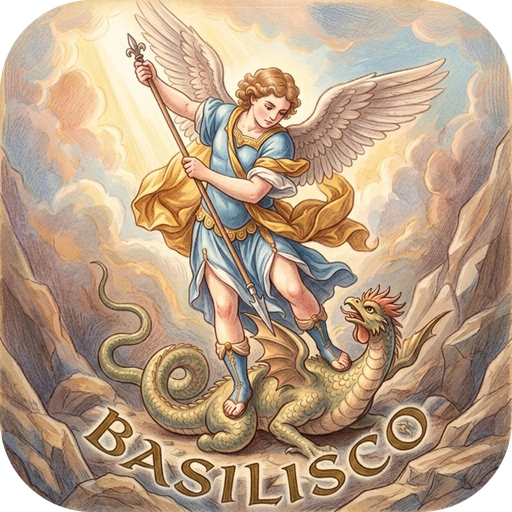

<p align="center"></p>

# 🐍 Proyecto Basilisco

**Proyecto Basilisco** es un launcher de videojuegos para PC que reúne en un solo lugar **todos tus juegos**, estén donde estén: en tu biblioteca de Steam o sueltos en cualquier carpeta de tu disco.

Es **100 % portable**: un único `.exe`, sin instalación de ningún tipo. Lo copias donde quieras (un USB, otro disco…) y funciona.

> ⚠️ Proyecto en fase inicial. Este README y la hoja de ruta irán cambiando con el tiempo.

---

## 📥 Descargar

Descarga el último `Basilisco-vX.Y.Z-win-x64.zip` desde **[Releases](https://github.com/sergio120602/Proyecto-Basilisco/releases)** y extráelo (con Windows, WinRAR o 7-Zip): sale una carpeta `Basilisco-vX.Y.Z` con `Basilisco.exe` y su carpeta de datos `basilisco-data`. Ábrelo y listo; no necesita instalar nada (ni siquiera .NET). También está el `.exe` suelto, por si lo prefieres.

Cuando sale una versión nueva, Basilisco lo avisa con un botón **Actualizar** arriba a la derecha: se descarga y se pone sola, conservando tu biblioteca.

La biblioteca, las portadas y los filtros se guardan en una carpeta `basilisco-data` junto al `.exe`, así que si mueves el `.exe`, mueve también esa carpeta.

## 🎯 Objetivo

Abrir Basilisco y ver de un vistazo toda tu colección de videojuegos en un carrusel de portadas, sin tener que saltar entre launchers ni buscar ejecutables por el explorador de archivos.

## 🎮 Controles

| Acción | Teclado / ratón |
| --- | --- |
| Navegar por el carrusel | `←` `→`, rueda del ratón o clic en una caja lateral |
| Abrir la caja (manual y disco) y jugar | `Enter` o clic en la caja central; en la caja abierta, `Enter` o «Jugar» (`Esc` para volver) |
| Girar la caja (ver grosor y contraportada) | Arrastrar la caja central con el ratón |
| Dar la vuelta a la caja | `R` |
| Importar juego | `I`, botón «Importar juego» o arrastrar archivos a la ventana |
| Importar tu cuenta de Steam (instalados, toda la biblioteca y Steam Familiar) | `S` o botón «Steam» |
| Importar una carpeta entera | `C`, botón «Importar carpeta» o arrastrar la carpeta a la ventana |
| Personalizar (nombre, portada, contraportada, lomo, disco, manual en PDF, consola, filtros, fondo, color de letras y tiempo de juego) | `E` o clic derecho sobre la caja |
| Cambiar el formato (cuadrada / rectangular) de uno, varios o todos | `F` o botón «Formato» |
| Encuadrar portada, contraportada o lomo | «Ajustar…» en Personalizar: rueda para ampliar, arrastrar para mover |
| Cambiar de filtro o de consola | `Tab` / `Shift+Tab`, o los menús **Consolas** y **Filtros** de arriba |
| Ordenar los juegos (personalizado, alfabético, lanzamiento, adición) | Menú **Orden** de arriba |
| Colocar los juegos a tu gusto | «Orden → Personalizado» abre la estantería: `↑` coger, `← →` mover, `↓` soltar, `Esc` terminar |
| Crear filtro | Menú **Filtros** → «+ Nuevo filtro…» |
| Editar o eliminar filtro | Menú **Filtros** → «Editar filtro», o clic derecho en Filtros |
| Quitar de la biblioteca | `Supr` (no borra nada del disco) |
| Fondo y color de las letras para todos los juegos | `A` o botón «Apariencia» |
| Modo nocturno (claro, nocturno o como Windows) | `N`, botón de la luna arriba a la derecha, o «Apariencia → Modo» |
| Zoom de las cajas | Barra «Zoom» abajo a la derecha, `Ctrl + rueda` o `+` / `−` |
| Alineación de las cajas (clásica, giradas hacia el fondo, o moderna, de frente en una fila recta) | Botón «Alineación moderna» abajo a la derecha |
| Subir o bajar las cajas | Barra «Altura» abajo a la derecha; «Auto» las baja solo lo justo para que el nombre del juego no las pise |
| Pantalla completa | `F11` (`Esc` para salir) |
| Actualizar a la versión nueva (cuando la hay) | `U` o botón «Actualizar a …» arriba a la derecha |

### 🕹️ Con mando

Funcionan los mandos de **Xbox One / Series / 360**, **PS5 (DualSense)** y **Nintendo Switch Pro** (también DualShock 4 y Joy-Con), por cable o Bluetooth.

| Acción | Xbox | PlayStation | Switch Pro |
| --- | --- | --- | --- |
| Navegar | Cruceta / stick izquierdo | Cruceta / stick izquierdo | Cruceta / stick izquierdo |
| Abrir la caja, jugar / aceptar | A | ✕ | A |
| Volver / cancelar | B | ○ | B |
| Dar la vuelta a la caja | X | □ | Y |
| Personalizar | Y | △ | X |
| Girar la caja | Stick derecho | Stick derecho | Stick derecho |
| Cambiar de filtro | LB / RB | L1 / R1 | L / R |
| Saltar de 5 en 5 | LT / RT | L2 / R2 | ZL / ZR |
| Formato | View | Create | − |
| Pantalla completa | Menu | Options | + |

Importar juegos y escribir nombres se sigue haciendo con teclado y ratón.

## ✨ Funcionalidades previstas

### 📚 Biblioteca de Steam
- Detección automática de la instalación de Steam.
- Lectura de las bibliotecas de Steam (incluidas las que estén en otros discos).
- Listado de todos los juegos instalados.
- Lanzamiento de los juegos directamente desde Basilisco.

### 📁 Importación de carpetas
- Importar juegos individuales desde cualquier carpeta. ✅ *(v0.0.1)*
- **Importar directorios completos**: seleccionar una carpeta y que Basilisco escanee todo su contenido para detectar los juegos que contiene. ✅ *(v0.0.6)*
- Detección de ejecutables de juego (descartando instaladores, desinstaladores, herramientas, etc.). ✅ *(v0.0.6)*
- Volver a escanear una carpeta para detectar juegos nuevos (los ya importados se marcan y no se duplican). ✅ *(v0.0.6)*

### 🎮 Biblioteca unificada
- Vista única con todos los juegos, vengan de donde vengan.
- Indicador del origen de cada juego (Steam, carpeta local…).
- Lanzar cualquier juego con un clic. ✅ *(v0.0.1)*

## 🗺️ Hoja de ruta

> La hoja de ruta se irá actualizando a medida que avance el proyecto.

- [x] Crear el repositorio y el README inicial
- [x] Elegir tecnología → C# + WPF (.NET 10), compilado como `.exe` portable
- [x] **Paso 1 · v0.0.1** — El `.exe` abre, carrusel 3D con cajas negras, importar y lanzar cualquier juego o aplicación
- [x] **Paso 2 · v0.0.2** — Menú de personalización: cambiar el nombre y la portada de cada juego
- [x] **Paso 3 · v0.0.3** — Filtros personalizados (con nombre e imagen) para agrupar los juegos
- [x] **Paso 4 · v0.0.5** — Personalización con imagen delantera y trasera de la caja
- [x] **Paso 5 · v0.0.5** — Girar las cajas como modelos 3D completos, con su grosor
- [x] **v0.0.11** — Descargar portadas de SteamGridDB y contraportadas de TheGamesDB desde Personalizar
- [x] **v0.1.0** — Consolas (PS1, PS2, PS3, PSP, Xbox, Xbox 360, GBA, Wii, Wii U, DS y PC): menú al importar y caja con el borde de cada consola
- [x] **v0.1.2** — Editor de encuadre para la contraportada y lomo personalizado (imagen propia o banner de TheGamesDB)
- [x] **v0.1.3** — Formatos de caja cuadrada (1024 × 1024) y rectangular (600 × 800), cada uno con sus imágenes
- [x] **v0.1.4** — Compatibilidad con mandos de Xbox One, PS5 y Switch Pro
- [x] **v0.1.5** — LaunchBox como segunda opción para portadas, contraportadas y lomos
- [x] **v0.1.6** — Cajas rectangulares con las medidas reales de cada consola
- [x] **v0.1.7** — Nintendo 64, GameCube y Game Boy Advance
- [x] **v0.1.8** — Cajas rectangulares sin franja, para portadas reales de LaunchBox
- [x] **v0.2.0** — Importar la cuenta de Steam: instalados, toda la biblioteca y Steam Familiar
- [x] **v0.2.1** — Consolas y filtros agrupados arriba, y orden personalizado, alfabético, por lanzamiento y por adición
- [x] **v0.2.2** — Orden personalizado en modo estantería: coger, mover y soltar los juegos por su lomo
- [x] **v0.2.3** — Cajas más grandes y barra de zoom
- [x] **v0.3.0** — Fondo estático o dinámico, color de las letras y tiempo de juego por juego
- [x] **v0.3.1** — Apariencia general (fondo y color de letras) para todos los juegos
- [x] **v0.3.3** — Los vídeos de fondo en VP9, AV1 o HEVC se convierten solos para que carguen
- [x] **v0.3.4** — Cajas rectangulares de PC en 600 × 900
- [x] **v0.3.5** — Logo de la aplicación
- [x] **v0.3.6** — Logo con esquinas redondeadas
- [x] **v0.3.7** — Horas de juego de Steam
- [x] **v0.3.8** — Lomos de The Spine Archive
- [x] **v0.3.9** — Caja de Wii U de 190 × 135 × 14 mm y tiempo de juego mientras el juego siga abierto
- [x] **v0.4.0** — Caja abierta con manual y disco (el disco gira al jugar), Steam Game Covers, y discos y manuales de LaunchBox
- [x] **v0.4.1** — Interfaz adaptada a cualquier resolución y botón para actualizar
- [x] **v0.5.0** — Manuales en PDF con datos de Steam y LaunchBox, y lector de manuales
- [x] **v0.5.1** — Modo nocturno
- [x] **v0.5.2** — Interior translúcido de las cajas y fondos de SteamGridDB
- [x] **v0.5.3** — Imagen del interior de la caja (propia o de SteamGridDB), nítida a través del plástico
- [x] **v0.5.4** — Ajustar el manual y el interior de la caja, y manuales originales de Vimm's Lair
- [x] **v0.5.5** — NES, Super Nintendo, Nintendo Switch y Arcade, y cartuchos de Nintendo 64, DS y Switch en la caja abierta
- [x] **v0.5.6** — Nombre del juego fijo y centrado arriba
- [x] **v0.5.7** — Altura de las cajas, a mano o automática según el zoom
- [x] **v0.5.8** — Menú de filtros en una franja con los logotipos en grande
- [x] **v0.5.9** — Logotipos de SteamGridDB para los filtros
- [x] **v0.6.0** — Alineación moderna, botones rectangulares y menú de consolas con imágenes de LaunchBox
- [x] **v0.6.1** — Alineación moderna en fila recta, de frente
- [x] **v0.6.2** — Arranque más rápido, menos memoria y opciones de rendimiento
- [x] **v0.6.3** — Carrusel más fluido: cajas pintadas en bloques de 50 y sin reflejos
- [x] **v0.6.4** — Descarga automática de todas las partes con prioridades y botón «Descarga Metadatos Actualización»
- [x] **v0.6.5** — Cajas de Steam: franja de Steam en la portada y el lomo, con la carátula en 2:3
- [x] **v0.6.6** — Contraportadas adaptadas al tamaño de la portada, con el interruptor «Adaptada»
- [x] **v0.6.7** — Menú «Steam familiar» con cada miembro, portadas cuadradas de SteamGridDB, pantallas 21:9 y descarga en .zip
- [x] **v0.6.8** — Buscador de juegos arriba y lomos de Steam Game Covers bien recortados
- [x] **v0.6.9** — Atajos de teclado en un menú, tiempo de juego en las etiquetas y barra de logros de Steam
- [x] **v0.6.10** — Alineación, altura, zoom y descarga de metadatos arriba, a los lados del título
- [x] **v0.6.11** — Página de logros con trofeos de bronce, plata, oro y platino
- [x] **v0.6.12** — Perfil de trofeos: crearlos a mano (también en bloque), RetroAchievements, RPCS3, PlayStation y traducción al español
- [x] **v0.6.13** — «Ver sus logros» de cada miembro de Steam familiar, comparando los juegos que tenéis varios
- [x] **v0.6.14** — Logros de los miembros con el token de sesión (perfiles en «solo amigos») y sin falsos «perfil privado»
- [ ] **Paso 6** — Descarga de cajas y carátulas según los filtros (PS1, PS2, PS3…) de forma automática
- [ ] Tamaño de las cajas a elección del jugador
- [x] **v0.0.6** — Importar directorios completos y escanearlos en busca de juegos

### 💡 Ideas para el futuro
- Información de cada juego (descripción, año, género…).
- Búsqueda por nombre y categorías automáticas (jugados recientemente, favoritos…).
- Soporte para otras plataformas (Epic Games, GOG, Xbox, etc.).

## 🎮 Consolas

Cada vez que importas juegos, Basilisco te pregunta de qué consola son: **PS1, PS2, PS3, PSP, Xbox, Xbox 360, NES, Super Nintendo, Nintendo 64, GameCube, Wii, Wii U, Nintendo Switch, Game Boy, Game Boy Advance, Nintendo DS, Arcade o PC**. La caja de cada juego lleva la franja y el color de plástico de su consola, y las consolas con juegos aparecen como pestañas arriba. Puedes mover un juego de consola en Personalizar (`E`).

Para usar las franjas oficiales, pon una imagen de cada franja en `basilisco-data/borders/` junto al `.exe`, con el nombre de su consola: `ps1.png`, `ps2.png`, `ps3.png`, `psp.png`, `gb.png` (Game Boy), `gba.png` (Game Boy Advance), `n64.png`, `gc.png`, `nds.png`, `wii.png`, `wiiu.png`, `xbox.png`, `x360.png` y `pc.png`. Si falta alguna, Basilisco dibuja la suya. Las franjas oficiales no se incluyen en este repositorio porque llevan logotipos de sus marcas.

## 🎮 Steam

Con el botón **Steam** (o la tecla `S`) importas tu cuenta de Steam:

- **Juegos instalados**: se leen de tu instalación de Steam, sin clave ni internet.
- **Toda la biblioteca** (también lo no instalado): con tu [clave de la Web API de Steam](https://steamcommunity.com/dev/apikey) (gratuita; tu perfil debe tener los «Detalles de juegos» públicos) o con el token de sesión.
- **Steam Familiar**: los juegos que te comparte tu familia. Steam solo los da con un **token de sesión**: con la sesión de Steam iniciada en el navegador, abre [esta página](https://store.steampowered.com/pointssummary/ajaxgetasyncconfig), copia todo el texto y pégalo en Basilisco. Dura unas 24 horas y Basilisco no lo guarda en ningún archivo.

Los juegos de Steam se lanzan a través de Steam; si no están instalados, Steam ofrece instalarlos. Puedes volver a importar cuando quieras: lo que ya tenías no se duplica.

Las **horas de juego** de los juegos de Steam son las de Steam: se leen del Steam de tu PC cada vez que abres Basilisco o vuelves a él (y, si has puesto la clave de la Web API, también de los servidores de Steam, que cuentan lo jugado en otros PC).

## 💿 Caja abierta

Al darle a un juego se abre su caja: la tapa gira sobre el lomo y deja ver el **manual** a la izquierda y el **disco** a la derecha, en su bandeja. Al darle a **Jugar**, el disco gira, se inicia el juego y la caja se cierra sola.

En Nintendo 64, Nintendo DS y Nintendo Switch, en lugar del disco va su cartucho, que sale de la caja al darle a Jugar. El interior de la caja es de plástico translúcido del color de su consola. En Personalizar («Interior de la caja») puedes poner una imagen tuya o de SteamGridDB, que se ve nítida a través del plástico, de lado a lado de la caja abierta.

El disco y el manual se eligen en Personalizar (`E`): una imagen tuya, un disco de Steam Game Covers o de LaunchBox, o para el manual un póster, un fondo o la pantalla de título de LaunchBox. Si no tienen imagen, el disco se dibuja con la portada y el manual es un librito con el nombre del juego.

## 📖 Manuales

Cada juego puede tener su **manual en PDF**. Desde la caja abierta, **Leer el manual** (`M`, X en el mando o un clic en el librito) lo abre en un lector como un librito, que se pasa con las flechas, la rueda o el mando. Si aún no tiene, Basilisco lo escribe en ese momento con la información de la tienda de **Steam** (en español: descripción, ficha, requisitos, idiomas y capturas) y, para los juegos que no están en Steam, de **LaunchBox**. En Personalizar también puedes crearlo, poner un PDF tuyo, buscar el **manual original escaneado en [Vimm's Lair](https://vimm.net/manual)** (se abre en el navegador para descargarlo y Basilisco lo recoge de tu carpeta de Descargas) o quitarlo. La imagen del librito y la del interior de la caja se pueden **ajustar** (ampliar y mover). Se guardan en `basilisco-data/manuals/`.

## 📦 Formatos de caja

Cada juego puede usar una caja **cuadrada** (carátula de 1024 × 1024, franja de la consola a la izquierda) o **rectangular** (sin franja: la carátula ocupa toda la portada, ideal para las portadas reales de LaunchBox, y con las medidas reales de la caja de su consola: jewel case en PS1, DVD en PS2/Xbox/Wii, 600 × 900 en PC, Blu-ray en PS3, caja de 190 × 135 × 14 mm en Wii U, UMD en PSP, cartón en Game Boy y estuche de DS). Cada formato guarda sus propias imágenes, así que puedes cambiar de uno a otro sin perder nada.

## 🌐 Carátulas desde internet

En Personalizar (`E`) puedes buscar y descargar la portada en **SteamGridDB**, y la contraportada y el lomo en **TheGamesDB** (para el lomo se usan sus *banners*, girados). Cada servicio necesita tu propia clave de API (gratuita), que Basilisco te pide la primera vez:

- **SteamGridDB**: entra en [steamgriddb.com](https://www.steamgriddb.com) con tu cuenta → Preferencias → API → genera la clave. Es inmediata.
- **TheGamesDB**: entra en [thegamesdb.net](https://thegamesdb.net) con tu cuenta y pulsa «API Access Request» al pie de la página. Tienen que aprobarla y tiene un límite de consultas al mes.

Como segunda opción, cada cara tiene un botón **Buscar en LaunchBox**: fotos reales de las cajas (portada, contraportada y lomo) de casi 200 000 juegos de la [base de datos de LaunchBox](https://gamesdb.launchbox-app.com/), de varias regiones. No necesita clave: la primera vez descarga su base de datos (unos 100 MB) y la guarda resumida en `basilisco-data/launchbox/`; después las búsquedas son instantáneas.

Para el lomo hay una tercera opción, **Buscar en The Spine Archive**: más de 11 000 lomos hechos por la comunidad de [The Spine Archive](https://thespinearchive.com/) (r/SwitchSpines). Están pensados para las cajas de Switch, pero sirven para cualquier caja (con «Ajustar…» los encuadras). No necesita clave: el catálogo (unos 7 MB) se guarda en `basilisco-data/spinearchive/` y se actualiza solo cada semana.

**Steam Game Covers** ([steamgamecovers.com](https://www.steamgamecovers.com/)) es otra opción sin clave para la portada, la contraportada, el lomo y el disco. Sus carátulas son plantillas para imprimir: Basilisco quita los márgenes, las guías y los textos, y separa las carátulas completas (DVD y Blu-ray) en portada, lomo y contraportada, que rellenan las caras que estén vacías. Las imágenes son de sus autores y de los dueños de cada juego: úsalas solo para tu colección.

Las claves se guardan en `basilisco-data/settings.json`, junto al `.exe`. No compartas esa carpeta si no quieres compartir tus claves.

## 🛠️ Tecnologías

- **C# / .NET 10** con **WPF** para la interfaz.
- Carrusel 3D hecho con `Viewport3D` de WPF: cada juego es una caja 3D con sus seis caras y su reflejo.
- Publicado como `.exe` autocontenido de un solo archivo (`PublishSingleFile`).
- Mandos con [SDL3](https://www.libsdl.org/) a través de [SDL3-CS](https://github.com/ppy/SDL3-CS).

### Compilar desde el código

Necesitas el [SDK de .NET 10](https://dotnet.microsoft.com/download).

```powershell
dotnet publish src/Basilisco/Basilisco.csproj -c Release -o dist
```

El `.exe` portable queda en `dist/Basilisco.exe`.

### Publicar una nueva versión

1. Sube `<Version>` en [`src/Basilisco/Basilisco.csproj`](src/Basilisco/Basilisco.csproj).
2. Añade la sección de la versión en [`CHANGELOG.md`](CHANGELOG.md) y haz commit.
3. Ejecuta `./scripts/release.ps1`: compila, sube el código, crea la etiqueta y publica la Release con el `.exe`.

## 📄 Licencia

Por decidir.
